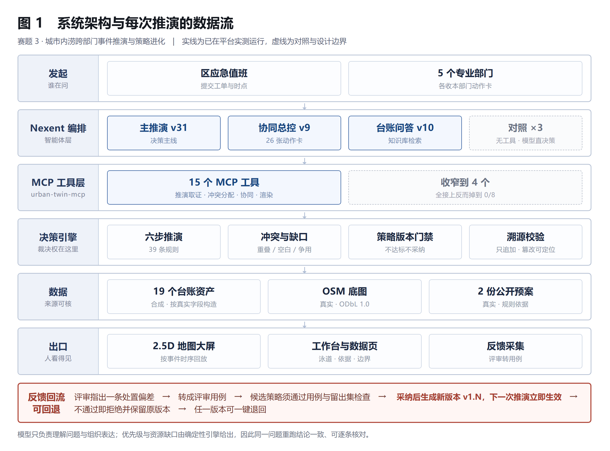
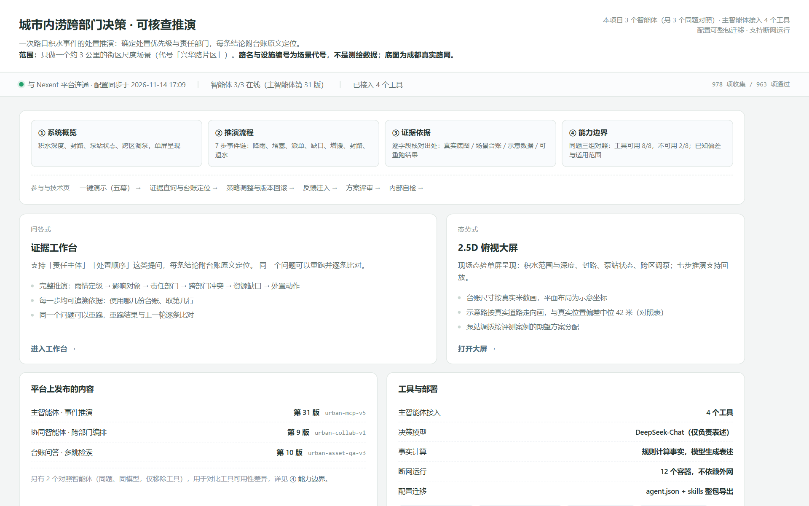
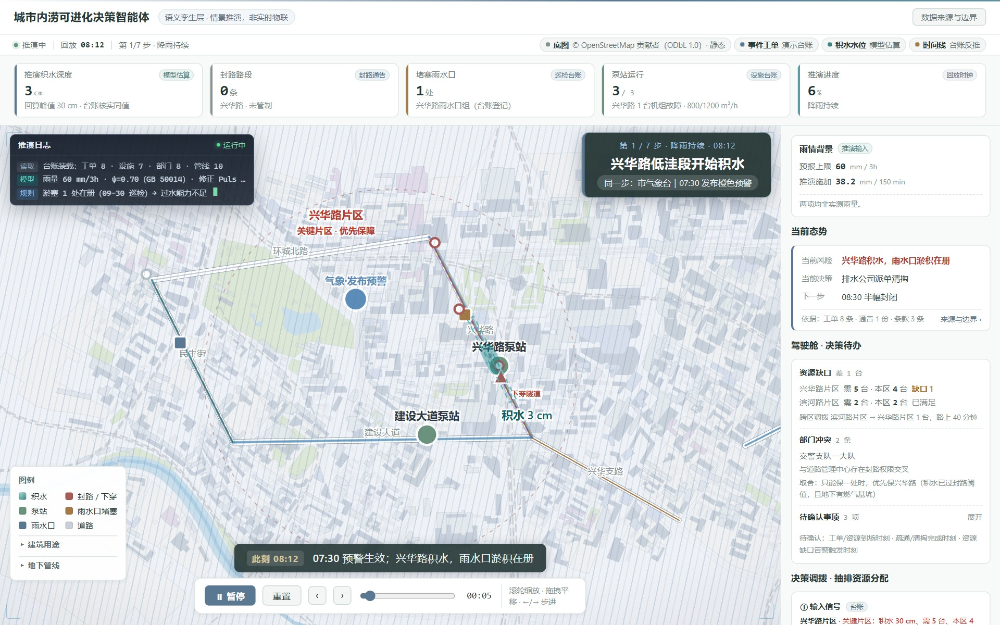
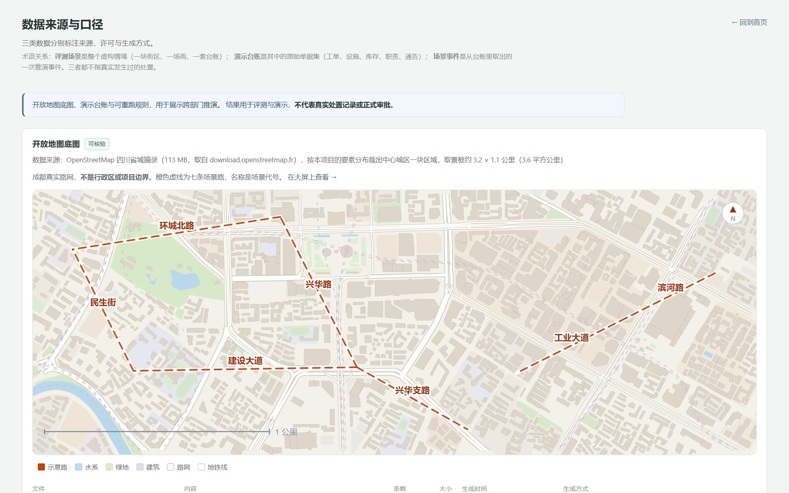
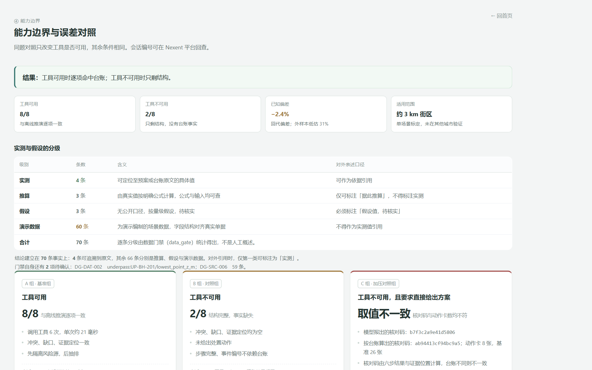
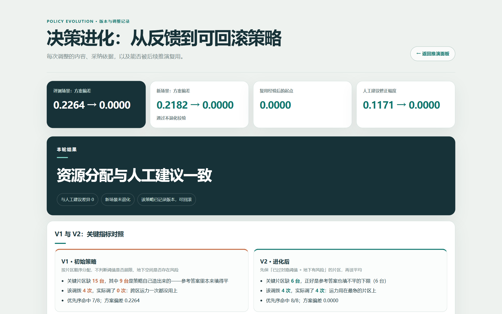

# 城市内涝跨部门决策智能体

**基于华为 ModelEngine Nexent 的可进化决策智能体** · 第十一届华为 ICT 大赛创新赛 · 赛题 3

面向城市内涝跨部门处置场景，本项目以一条受影响道路的一次积水事件为例，串联应急协调、排水、道路、交管、燃气和供电等部门，将事实核验、风险隔离、资源调配与恢复通行复核组织成一条**可追溯、可回滚、能从反馈中改进**的决策链。

> **范围先讲清楚**：本系统提供语义孪生层与情景推演能力，面向**离线与回放**的决策验证；实时物联接入、SCADA 与设备控制回路属于当前范围之外。底图与预案是真实公开数据，设施台账是合成数据。

<p align="center"></p>

<p align="center"><sub>
<a href="#可复核结果">核验结果</a> &nbsp;·&nbsp;
<a href="#问题定义">问题定义</a> &nbsp;·&nbsp;
<a href="#一个完整事件从上报到恢复通行">事件经过</a> &nbsp;·&nbsp;
<a href="#快速开始">快速开始</a> &nbsp;·&nbsp;
<a href="#策略演化机制">策略演化</a> &nbsp;·&nbsp;
<a href="#已知限制">已知限制</a>
</sub></p>

---

## 界面

<p align="center"></p>

<p align="center"><sub>门户：一次事件的结论、可核对指标、三组对照与数据来源，一屏读完</sub></p>

| | |
|---|---|
| <br><sub>2.5D 大屏 — 逐拍推演，左侧日志写出每一步读了哪本账、依据哪条规则</sub> | <br><sub>数据台账 — 开放底图与设施台账，每项标注来源与分级</sub> |
| <br><sub>能力边界 — 同题三组对照，工具不可用时能说对多少、错在哪</sub> | <br><sub>策略演化 — 偏差归零、被拒的一轮与回退验证</sub> |

---

## 可复核结果

| 指标 | 实测值 | 核验方式 |
|---|---|---|
| **一致性** | **8/8**（v34，4 个事件各一次对话通过） | `samples/nexent/live/multi_event_regression.json` |
| **MCP 工具** | **15 个**（11 在线决策 + 4 离线渲染），主入口只接 4 个 | `deploy/nexent/setup_nexent.py status` |
| **策略演化** | **v1.0 → v1.2**，偏差 `0.2264 → 0.0000`，含 1 轮被拒与回退验证 | `uv run python -m decision_poc.policy_evolution` |
| **溯源** | 引用完整率 **100%**，每条结论定位到台账原文的具体行 | `uv run python -m decision_poc.evidence_check`（108/108） |

---

## 问题定义

内涝处置的难点在于，**同一场降雨进入不同部门的业务流程后，往往会形成不同的处置判断**：

- 排水部门关注积水深度，优先考虑抽排；交管部门关注通行安全，优先考虑封路；住建部门关注在建基坑，优先考虑停工；
- 预案、台账、交底记录分散在不同材料中，各方都能找到局部依据，但缺少统一、可核对的处置结论。

本项目不构建预报模型，而是将判断过程组织成可执行、可核对、可改进的流程。一次决策请求的输出包括：

| 输出 | 内容 |
|---|---|
| 六步推演 | 雨情 → 影响对象 → 责任部门 → 职责冲突 → 资源缺口 → 处置动作 |
| 每条结论的出处 | 文件名 + 行号 / 表格行，点开即原文 |
| 三类冲突 | 职责重叠 / 职责空白 / 资源争用，附建议主责部门 |
| 需人工接手 | 哪些判断超出数据边界、哪些动作必须现场确认 |

---

## 一个完整事件：从上报到恢复通行

以下以工单 `WO-20261029-007` 为例，推演时点为 `2026-10-29 09:40`。它不是把事故写成故事，而是把工单、设施台账、施工状态和部门职责串成一条可复核的处置链。完整证据见 [`docs/urban-scenario-ground-truth.md`](docs/urban-scenario-ground-truth.md)。

### 参与部门

| 部门 | 在本事件中的职责 |
|---|---|
| 应急协调 | 汇总各部门判断，处理职责冲突，决定联合发布和处置先后。 |
| 排水 | 核查雨水口和泵站状态，组织清掏、抽排，并上报排水能力缺口。 |
| 道路 | 判断道路和施工区域的安全状态，提出封闭范围和恢复条件。 |
| 交管 | 执行交通管制，组织绕行，评估施工封闭与积水叠加后的通行影响。 |
| 燃气 | 停止涉险施工，开展燃气检测，确认管线悬空、泄漏等风险。 |
| 供电 | 配合泵站和施工区域的电气隔离，核查备用电源与用电安全。 |

### 事件经过与阶段结论

| 时点 | 已确认事实 | 处置动作 | 阶段结论 |
|---|---|---|---|
| 07:30–08:00 | 预警发布并进入生效窗口。 | 应急协调将事件纳入联动范围，排水、道路、交管进入待命。 | 事件从单点积水监测升级为跨部门处置。 |
| 08:30 | 兴华路施工占道，半幅封闭已生效。 | 道路与交管共同维护施工封闭和后续绕行条件。 | 后续积水处置不能只看排水，还要同步评估通行和疏散路径。 |
| 09:20 | A-03 兴华路 K0+320 积水约 30 cm，DF-IN-101 雨水口反涌；DF-PS-01 既有泵组故障，且无备用电源。 | 排水核查进水口和泵站能力；道路、交管研判全幅封闭。 | R-101 进入全幅封闭研判，排水能力不足是主要约束。 |
| 09:30 | B-01 滨河路积水约 18 cm，尚未达到封路阈值，泵站运行正常。 | 保持监测，作为跨区调配资源的候选来源。 | B-01 暂不封路，但可承担资源支援角色。 |
| 09:35 | A-03 燃气施工基坑东侧沉陷，坑内积水上涨。 | 立即停工、隔离燃气和电气风险，开展燃气检测；应急协调组织燃气、供电、道路、排水联合处置。 | 基坑安全优先级高于恢复通行，未完成安全确认前不得复工。 |
| 09:40 | 推演识别出道路与交管的联合发布、泵站运维主体缺口和移动泵资源争用。 | 按“风险隔离 → 封闭受影响道路和下穿通道 → 清掏雨水口并抽排 → 跨区调泵 → 组织绕行 → 水位与管道复检”执行。 | 当前数据支持明确处置顺序，但不能把推演顺序当作现场已完成结果。 |
| 后续 | 台账未记录实际到场、清掏完成和恢复通行时刻。 | 继续以水位、泵站状态、燃气检测和管道安全复核作为放行条件。 | 恢复通行只能在现场复核通过后确认，系统不虚构完成时间。 |

这条事件链最终给出四个结论：**R-101 需要全幅封闭研判；A-03 先处置基坑、燃气和供电风险；DF-IN-101 清掏与泵站能力恢复是抽排前提；现有移动泵资源不足时必须跨区调配，并由应急协调统一排序。**

---

## 三个智能体与一个确定性引擎

| 智能体 | 版本 | 接入工具 | 职责 |
|---|---|---|---|
| 城市内涝跨部门决策智能体 | v34 | 4 个 | 输入工单号，输出六步推演与处置顺序 |
| 城市内涝应急协同总控 | v12 | 6 个 | 拆成 1 总控 + 5 部门动作卡，排联合发布与先后 |
| 内涝资产台账问答 | v11 | 平台知识库 | 设施状态、路段属性、预案条款查证 |
| 对照 ×3 | v2 | 0 | 无工具版 ×2、模型直决策 ×1，用于证明工具链的必要性 |

模型统一使用 DeepSeek-Chat。**工具清单本身就是模型读的提示词**：12 个工具全挂、技能正文又要求逐个调 `twin_neighbors` / `conflict_check` / `allocation_plan` 时，模型绕开结论接口，回答截断在 `<|tool_call_start|>`，8/8 掉到 0/8（conversation 74/75）；把工具收窄到两个后恢复 8/8（conversation 78）。而同一批 12 个工具单独挂着时是 8/8（conversation 59）——退化来自「清单里有什么 + 技能正文要求什么」，不是数量。收窄不是一步到 4 个：先只挂 `event_deduce` + `evidence_locate` 两个即恢复 8/8，2026-11-13 加 `doc_search`、11-14 加 `collab_run` 才是现在的 4 个。

**裁决权归确定性规则引擎**（39 条规则，每条带预案原文行号，加载时校验），模型只负责理解问题与组织表达。因此同一问题重跑时结论保持一致，替换模型也不应改变裁决结果，变化仅限于表达形式。

---

## 证据边界与对照实验

本项目不以"0 幻觉"作为结论，因为现有证据无法直接证明这一表述。当前提供三组对照实验：

- 同一提示词、**不接工具**：只完成 **2/8**，主动说明"无法取证，不输出结论"；
- 要求它**凭经验出方案**：编出一个格式完全正确、但数值是假的编排结果（动作卡 8 张，真实 26 张）；
- 结论**必须带原文出处**，缺一段引用就降级为"无法支撑"，不允许补解释。

对照结果表明，**模型不承担最终裁决，是审计约束，而不是对模型能力的泛化判断。**

对应到数据本身，每一类都标了性质：

| 数据 | 来源 | 性质 |
|---|---|---|
| 路网、建筑轮廓 | OpenStreetMap（ODbL 1.0） | **真实** |
| 防汛预案、处置规程 | 市级公开预案原文 | **真实** |
| 设施台账、工单事件 | 按真实字段结构构造 | 合成 |
| 积水深度过程 | 规则计算 + 场景设定 | 计算/示意 |

当前不声明：模型精度、实时监测、数字孪生平台、省人力百分比。

---

## 快速开始

```bash
uv sync --locked                                       # 约 11 秒，自动取对版本 Python
uv run python -m decision_poc.web_demo --port 8790     # 浏览器开 http://127.0.0.1:8790
```

如需执行完整测试、推演、策略演化和自检：`uv run python scripts/reproduce.py`（约 40 秒）。

源码开发、断网现场演示、公网隧道三种场景各有一个启动入口，端口与凭据的差异写在 `docs/demo-runbook.md`。现场演示不依赖云端接口；未配置模型凭据时，工作台推演类问答走本地直出（回答以「离线直出」开头，不冒称平台回答），台账问答需要平台访问凭据，未配置时明确提示而不返回推测结论，这是设计行为而非故障。

### 新拉取的仓库怎么跑

- 不需要配置任何模型凭据。仓库里没有 `.env`，也没有 Key；页面在无凭据下的降级路径是默认路径，不是异常路径。
- 先跑一次 `scripts/reproduce.py`。它补齐 `out/` 下大屏依赖的过程线与事件时标（`out/` 整个目录在 `.gitignore` 里，克隆下来并不存在，由这一步建出来），缺它们时 `/map2d` 会静默退回手写的示意节奏，`scripts/demo_tour.py --check` 会报缺文件。
- `deploy/` 下三条部署路径依赖 Docker 与 Nexent 平台，本地演示不必执行；`deploy/nexent/` 的脚本打真实平台，需要凭据与网络，进不了 CI。

演示页 `/show` 将 `/map2d` 作为底图嵌入，按「收到工单 → 冲突曝光 → 策略进化 → 重新推演 → 大屏退水」五幕推进，
演示数据全部来自本机接口；按空格推进，`?beat=3` 可单独排练某一幕。底图缺失时使用示意图，并由自检报告该状态。

> 仅需安装 [uv](https://docs.astral.sh/uv/)，无需预装 Python。

<details>
<summary>更多单点命令</summary>

```bash
uv run python -m decision_poc.deduction --event WO-20261029-007 --as-of 2026-10-29T09:40:00+08:00
uv run python -m decision_poc.evidence_check    # 期望 108/108，校验值 a63cbf4f9fc53c6e
```

</details>

---

## 策略演化机制

这里的策略演化不涉及模型微调，而是将**稀缺资源分配策略**做成有版本、可评测、可回退的一层：

```
人工评审指出偏差 → 转成评审用例 → 候选策略须通过「留出集不退化 + 不违反评审用例」两项约束
→ 采纳则生成 v1.N 并在下一次推演生效 → 不通过即拒绝并保留原版本 → 任一版本均可回退
```

实测量化：训练集偏差 `0.2264 → 0.0000`，留出集 `0.2182 → 0.0000`；策略生效后 A-03 片区 **4→6 台**、B-01 **2→0 台**，关键片区未满足数 15→6，应调拨未调拨 4→0。

---

## 已知限制

1. 单片区（成都兴华路约 3 公里）做到逐行可核对；方案可迁移，**标定参数不可迁移**。
2. 资源缺口当前按"额定能力 × 0.8 保守折算"，属折算口径，**不是水力模型测算值**。
3. 可视化：地图大屏为 SVG 现场生成，三维画面为离线渲染成片，不是实时引擎视口。**受演示机内存限制**（8 GB 无法承载实时 WebGL 场景），改用离线渲染 + 相机路径预演；设备条件允许后可切换为实时引擎视口，属后续规划。
4. 分层记忆：进化循环在离线同构实现中跑通；平台侧只验证了 agent 层短期记忆（写入、召回、上下文注入、跨用户隔离，2026-11-22 实测，探针已清理），租户/用户两层的长期记忆没有写入。
5. 平台导出智能体配置时未完整带出 MCP 工具绑定（已定位到平台侧函数），工具清单以配置文档为准。

---

## 文档导航

| 内容 | 位置 |
|---|---|
| **全部文档的阅读顺序** | [`docs/README.md`](docs/README.md)（六步读法 + 七类分层） |
| 技术设计与边界分析 | `docs/`（`nexent-*` 系列、`technical-baseline.md`） |
| 平台实测证据（会话号/耗时/校验值） | `samples/nexent/live/` |
| **数据目录与性质分类** | [`samples/README.md`](samples/README.md) |
| **脚本索引（A–H 分组）** | [`scripts/README.md`](scripts/README.md) |
| **部署三条路径** | [`deploy/README.md`](deploy/README.md) |
| 平台装配与复现 | `deploy/nexent/README.md` |
| 完整的工程说明（安装、部署、调试） | [`docs/README-dev.md`](docs/README-dev.md) |

<details>
<summary>仓库结构</summary>

| 目录 | 内容 |
|---|---|
| `src/decision_poc/` | 决策引擎：推演、溯源、策略演化、协同、定量、智能体接入、页面服务 |
| `src/decision_poc/collab/` | 多智能体协同：角色、契约、协同板、编排器 |
| `src/decision_poc/quant/` | 定量层：水文、水力、简化水动力、可靠性、不确定性 |
| `scripts/` | 生成器、证据核对、界面自动检查。入口是 `reproduce.py`，其余脚本都从它串起来；分组索引见 [`scripts/README.md`](scripts/README.md) |
| `tests/` | 981 项收集 / 967 通过 / 14 项按设计跳过（本轮隔离工作树实测，0 失败） |
| `samples/` | 资产台账 `assets/`、规则库 `rules/`、评测用例 `eval/`、平台实测证据 `nexent/` |
| `docs/` | 设计与验收文档。**先读 [`docs/README.md`](docs/README.md)** —— 它按阅读顺序编排，不按文件名字母序 |
| `deploy/` | 三条部署路径，见 [`deploy/README.md`](deploy/README.md)：`nexent/` 平台装配、`offline/` 离线包、`mcp_sse/` MCP 容器 |
| `.github/workflows/` | CI 五道闸：锁文件、编译、测试、对外数字自检、复现快检 |

</details>

---

## 许可

MIT，见 `LICENSE`。
