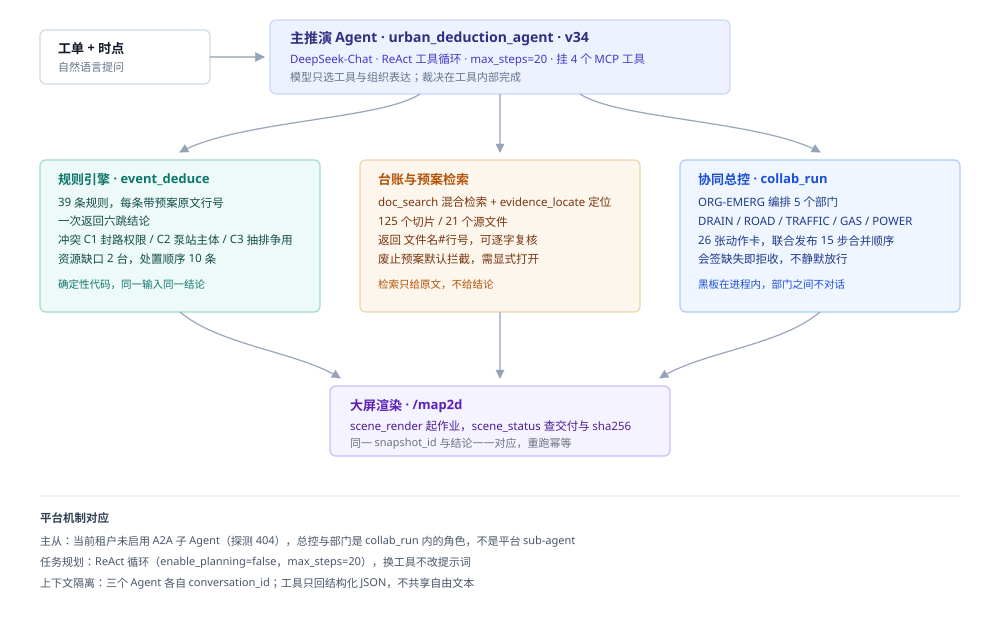

# Nexent 平台能力证据包（初赛）

更新时间：2026-11-22。这份文档只回答一件事：**「基于 Nexent 可运行」这一项，每一格证据在哪、怎么复核、哪一格还没测**。
每条结论都指向仓库内可读的文件，不指向截图观感。

> 这是**内部核对稿**，用工程术语（指纹、快照、挂载、内核）写是为了能对上源码。摘进答辩材料前要按对外口径改写一遍，别整段搬。

## 0 六项对账

| 项 | 结论 | 主要证据 | 状态 |
|---|---|---|---|
| Agent 配置导出 | 三个业务 Agent 的版本/模型/工具/技能/模式已固化为 JSON；**平台导出包不能代表已发布版本** | `samples/nexent/live/agent_config_summary.json` | 已补，附导出缺陷实测 |
| MCP 接入方式 | 4 个主工具同属一个容器内 SSE 端点，不是"远程地址"也不是"OpenAPI 转 MCP" | `samples/nexent/live/mcp_status.json`、`samples/nexent/tools.json` | 已补，`/health` 现场抓取 |
| 知识库 | 单索引 125 个切片 / 21 个源文件，引用回 `文件名#行号` | `samples/nexent/live/kb_chunks.json`、`samples/nexent/live/platform_qa_current.json` | 已补；**未按四类分库**，见 §3.4 |
| 多智能体调用图 | 主 Agent → 三组工具 → 大屏；总控与 5 部门在 `collab_run` 内，不是平台 sub-agent | `docs/figures/nexent-multiagent-callgraph.svg` | 已补，含平台机制对照 |
| 分层记忆 | 离线同构五步全过；平台侧**零次**真实写入与召回 | `docs/reports/nexent-memory-walkthrough.md`、`samples/eval/decision_memory.json` | 未补完，原因与补齐命令见 §5 |
| 调试迭代 | 版本—会话号—结论可逐条对上；CI 五道闸有运行记录 | `docs/reports/nexent-live-integration-report.md`、`docs/reports/ci-runs.json` | 已补；顺带更正一处口径 |

重新生成上面三份 JSON：

```powershell
$env:PYTHONPATH = "src"
uv run --locked python deploy/nexent/export_capability_pack.py --with-mcp-health
```

生成器只读快照与源码常量，不连平台；`--with-mcp-health` 会在本地临时起一个 MCP SSE 进程抓 `/health`，抓完即杀。

文中的 `Nexent/...` 指平台源码在这台机器上的检出（`Nexent/VERSION` = v2.7.0），**不随本仓库分发**；引用行号只用于确认平台行为，换平台版本需重新对一遍。

---

## 1 Agent 配置导出

### 1.1 三个业务 Agent 的配置

| 字段 | 主推演 | 协同总控 | 台账问答 |
|---|---|---|---|
| 平台名称 | `urban_deduction_agent` | `urban_collab_agent` | `urban_asset_qa` |
| 发布版本 | **v34**（`urban-mcp-v5`） | **v12**（`urban-collab-v1`） | **v11**（`urban-asset-qa-v4`） |
| 模型 | DeepSeek-Chat（`deepseek-chat`，`api.deepseek.com/v1`，max_tokens 8192） | 同 | 同 |
| 采样温度 | 未覆盖（`model_params_override` 只有空 `extra_params`）→ 平台/服务商默认 | 同 | 同 |
| 执行模式 | ReAct 工具循环，`max_steps=20`，`enable_planning=false` | 同 | `max_steps=12` |
| 输出预算 | `requested_output_tokens=8192` | 8192 | 未设 |
| 挂载工具 | 4：`event_deduce` / `evidence_locate` / `doc_search` / `collab_run` | 6：`event_deduce` / `twin_neighbors` / `conflict_check` / `allocation_plan` / `evidence_locate` / `collab_run` | 1：平台内置 `knowledge_base_search` |
| 技能 | 2 个；绑定快照（v19，11-06）草稿与发布两侧均 enabled，v34 未重抓 | 无 | 无 |

温度写"未覆盖"而不是编一个数字：`temperature=0` 试过，模型在工具调用之后返回空回答（conversation 76/77），已回退默认；`model_params_override` 里没有 `temperature` 字段，平台按模型级默认走。**复现不依赖这个值**——裁决在确定性代码里，模型只负责选工具与组织表达。

`enable_planning` 说明：导出件**不含**该字段，取值来自平台后端默认（`Nexent/backend/agents/create_agent_info.py:1318`，`enable_planning: bool = False`）。所以本项目是 ReAct 循环，不是 plan-and-execute。

### 1.2 平台导出包为什么不能当 v34 的配置证据

实测三条，都能自己复核：

1. `/agent/export` 路由调用实现时**没传版本号**（`Nexent/backend/apps/agent_app.py:662`），实现签名默认 `version_no=0`（`management.py:1410`）——导的是**草稿**。
2. 草稿的工具绑定落后于已发布版本：主 Agent 导出包只有 2 个工具（`collab_run`、`doc_search`），发布版是 4 个；协同 Agent 导出包 **0 个工具、0 个技能**，发布版是 6 个。
3. 于是导出包与发布版本不等价。`agent_config_summary.json` 里每个 Agent 都有 `draft_vs_published` 字段记录这个差集。

提交口径：**交配置摘要 JSON，同时把导出缺陷说明附上**。反过来做（交导出包、声称就是 v34）会被评委当场对照出来。

平台在线时要拿真正的 v34 包，正确做法是在 backend 容器里直调实现并传版本号：

```bash
docker exec nexent-config sh -c "cd /opt/backend && .venv/bin/python -c \"
import asyncio, pathlib
from management.services.agent.management import export_agent_with_skills_impl
r = asyncio.run(export_agent_with_skills_impl(3, 'Bearer <token>', version_no=34))
pathlib.Path('/tmp/v34.zip').write_bytes(r['data'])
\""
```

> 这段**未实测**：平台栈当前没起（5013 端口能连但不回包，5010/3000 未监听），没有环境跑。字段签名出自源码，命令形态与 `export_bundle.py` 一致。

---

## 2 MCP 接入方式

### 2.1 一句话：一个服务，一种传输

平台「MCP 服务接入」有三种填法——远程地址、容器（容器名互访）、OpenAPI 转 MCP。本项目选**容器**：

| 项 | 值 | 依据 |
|---|---|---|
| 服务名 | `urban-twin-mcp` | `deploy/docker-compose.mcp.yml` |
| 平台侧地址 | `http://urban-twin-mcp:8000/sse` | 导出包 `mcp_info`、`deploy/nexent/setup_nexent.py` |
| 传输 | SSE（平台按 URL 后缀选：`/sse` → SSE，`/mcp` → Streamable HTTP） | `src/decision_poc/mcp_sse.py` |
| 4 个主工具 | 同一个端点的四个工具，不存在"分别接入" | `samples/nexent/tools.json` 的 `groups` |

**为什么不是远程地址**：`host.docker.internal:8000` 从 Nexent 容器出不去，被本机防火墙拦，加规则要管理员权限；改成容器进 `nexent_network` 用容器名互访，绕开这一层。
**为什么不是 OpenAPI 转 MCP**：平台不存工具参数 schema（导出里 `params` 恒为空数组），转换只会把契约留在我们这边、平台那边只剩名字，反而更难核对。原生 MCP 实现本来就有，没必要多一跳。

### 2.2 15 个工具全量清单与状态

`/health` 现场抓取（2026-11-22，本地起同一个 `mcp_sse` 模块，与容器同源）：

```text
$ python -m decision_poc.mcp_sse --host 127.0.0.1 --port 8871
{"status":"ok","transport":"sse","server":"decision_poc.mcp_server","tools_count":15,
 "tools":["semantic_query","twin_neighbors","doc_search","evidence_locate","claim_trace",
 "provenance_verify","event_deduce","counterfactual_run","conflict_check","allocation_plan",
 "scene_render","scene_status","scene_compare","asset_lookup","collab_run"]}

$ python -m decision_poc.mcp_sse --port 8872 --groups presentation
{"status":"ok","transport":"sse","server":"decision_poc.mcp_server","tools_count":3,
 "tools":["scene_render","scene_status","scene_compare"]}
```

| 工具 | 分组 | 主 Agent | 协同 Agent | 作用 |
|---|---|---|---|---|
| `semantic_query` | decision | | | 语义层查询实体与关系 |
| `twin_neighbors` | decision | | ✓ | 邻接设施与影响范围 |
| `doc_search` | decision | ✓ | | 预案/台账/规程混合检索 |
| `evidence_locate` | decision | ✓ | ✓ | 按 `asset_id#locator` 取原文 |
| `claim_trace` | decision | | | 结论到证据的追溯 |
| `provenance_verify` | decision | | | 来源与版本校验 |
| `event_deduce` | decision | ✓ | ✓ | 六跳推演，一次返回全部事实 |
| `counterfactual_run` | decision | | | 反事实对比（CF1–CF6） |
| `conflict_check` | decision | | ✓ | 三类冲突 |
| `allocation_plan` | decision | | ✓ | 稀缺资源分配 |
| `scene_render` | presentation | | | 起渲染作业 |
| `scene_status` | presentation | | | 查交付状态与 sha256 |
| `scene_compare` | presentation | | | 两份状态差异 |
| `asset_lookup` | bootstrap | | | 资产就绪核对 |
| `collab_run` | collaboration | ✓ | ✓ | 总控 + 5 部门动作卡 |

分组不是装饰：`--groups presentation` 之后服务端只暴露 3 个渲染工具，推演阶段智能体看不见"换个镜头"这类选项，推理预算不会被它们吃掉。

---

## 3 知识库

### 3.1 建库与切分口径

| 项 | 值 |
|---|---|
| 索引名 / 形态 | `urban-flood-assets`，平台库里是 `2-<uuid>` 前缀形式 |
| 向量模型 | `bge-m3`（model id 3，建索引必带，否则 500） |
| 入库内容 | 9 份 Markdown（预案 4 + 规程 2 + 通告 2 + 说明 1）+ 10 份台账 CSV + 2 份外部资料 |
| 实测切片 | **125 条 / 21 个源文件 / 40 073 字** |

切分规则写在 `deploy/nexent/ingest_knowledge.py`，不是平台默认值：

- Markdown 按 `## ` 二级标题切，去掉 front matter，每块正文前缀「文档：<文件名>\n小节：<标题>」；
- CSV **一行一条记录**，正文前缀「台账：<文件名>（列：…）」+「记录 <主键>：k=v；…」。
  整篇当一个块的后果是：8 行台账压成千字块，命中后模型拿到的仍是全部行，等于没切。

### 3.2 引用怎么落到"文件名 + 行号"

每个切片的 `path_or_url` 就是定位符：

| 类型 | 定位符 | 示例 |
|---|---|---|
| CSV | `urban-assets/<文件>#row<行号>`（含表头，首条数据是 row2） | `urban-assets/drainage_facilities.csv#row4` |
| Markdown | `urban-assets/<文件>#<节序号>` | `urban-assets/plan_flood_emergency_v2.md#0` |

**Markdown 给的是节序号，不是行号**——这点必须说准。要精确到行的是自建 `doc_search`，它返回 `asset_id#locator` 形如 `AS-CD-CITY-...#line:31`。

平台实测引用（`samples/nexent/live/platform_qa_current.json`，2026-11-21，三问三中）：

| 问题 | 命中来源（节选） |
|---|---|
| A-03 片区有哪些泵站、设计流量多少 | `urban-assets/drainage_facilities.csv#row4`、`#row6`、`urban-assets/README.md#4` |
| 平台上的 urban_deduction_agent 跑哪个版本 | `platform-versions://snapshot`、`policy-ledger://flood-response-v1.2` |
| 当前生产策略版本与偏差降幅 | `policy-ledger://flood-response-v1.2` |

一处已知缺陷：平台运行时会要求检索型回答保留 `[[a1]]` 这类引用角标，没有配置项能关。三问里 **2/3 无角标、1/3 仍返回 `[[a1]]`**。网页端有展示层清理；北向原始 `final_answer` 要按 `marker_free` 字段验收，不能拿"界面上看不出来"当通过。

### 3.3 平台支持哪些格式

平台文件解析（`Nexent/sdk/nexent/data_process/extract_image.py:400-419`）：`.pdf` / `.xlsx` / `.pptx` 直接解析，`.doc` / `.docx` / `.ppt` / `.xls` 先经 LibreOffice 转格式再解析；文本类走直读。

**我们实测入库的只有 Markdown 与 CSV**（因为台账和预案原件就是这两类）。Word/PDF/PPT/Excel 的解析能力是平台能力，本项目**没有实测样本**，材料里别写成"我们验证了七种格式"。

### 3.4 与"底图/预案/台账/规则分别建库"的差异

当前是**一个索引**，四类资料靠 `path_or_url` 前缀区分，不是四个库。这是当初的取舍：

- 拆库等于在检索层给来源打标签，"这条依据来自预案还是台账"会变成检索前置条件，提问者得先知道自己该查哪个库；
- 单库 + 元数据（`filename` / `title`）已经能回答"出自哪份文件哪一行"，可溯源的要求不靠拆库满足。

代价要承认：单库里预案条文与台账记录会互相挤占 top-k。实测「A-03 片区有哪些泵站」这一问返回 18 条来源，与问题直接相关的只有 3 条（两座泵站 + 片区说明），其余是邻接资料。要拆的话成本不高——`ingest_knowledge.py --index <新库名> --only <文件列表>` 已经在，一次增量补录即可，但需要平台在线。**是否拆，是产品取舍，不是技术缺口。**

---

## 4 多智能体调用图

图见 `docs/figures/nexent-multiagent-callgraph.svg`：



链路与实现位置：

| 环节 | 实现 | 是否经过 LLM |
|---|---|---|
| 主推演 Agent 选工具 | 平台 ReAct 循环，4 个工具 | 是 |
| 规则引擎 | `event_deduce` → `deduction.load_rules()`，39 条规则 | 否 |
| 台账与预案检索 | `doc_search`（本地 RAG 索引）+ `evidence_locate`（取原文） | 否 |
| 协同总控 + 5 部门 | `collab_run` → `collab/orchestrator.py`，ORG-EMERG 编排 DRAIN/ROAD/TRAFFIC/GAS/POWER | 否 |
| 大屏渲染 | `scene_render` / `scene_status` → `/map2d` | 否 |

同一事件串联实测（`samples/nexent/live/chain_live.json`，`WO-20261029-007`）：主链 conversation 313、协同 314，`chain_ok=true`，内核指纹 `d7fa402fe22e596c` 与离线逐字一致，26 张动作卡、15 步合并顺序、6 个参与角色。

### 4.1 平台机制怎么对应（别说过头）

| 提法 | 平台现状 | 可以怎么说 |
|---|---|---|
| 主从 / 子 Agent | 当前租户**未启用** A2A：对 6 个 Agent 逐个探 `.well-known/agent-card.json` 全 404，列表不含 `endpoint_id` | "单 Agent + 工具编排；总控与 5 部门是 `collab_run` 内的确定角色，不是平台 sub-agent" |
| 任务规划 | `enable_planning=false`，运行在 ReAct 循环（`max_steps=20`） | "工具选择由 ReAct 循环驱动，没有开启规划模式" |
| 上下文隔离 | 三个 Agent 各自 `conversation_id`；工具只回结构化 JSON，部门间靠进程内黑板，不共享自由文本 | "上下文按会话隔离；协同不靠 Agent 间对话" |

平台源码里有 A2A 实现（`Nexent/backend/services/a2a_*`），但那属于**平台能力**，不等于本项目已启用。这两句分开写，别合成一句。

---

## 5 分层记忆

### 5.1 平台原生就是三级

`Nexent/backend/database/db_models.py:1052` 起的 `memory_records_t` 直接给了三层的隔离键，不需要我们自己造：

| 层 | 隔离键 | 字段取值 |
|---|---|---|
| 租户级 | `tenant_id` | `layer='tenant'` |
| 用户级 | `tenant_id + user_id` | `layer='user'` |
| Agent 级 | `tenant_id + user_id + agent_id (+ conversation_id)` | `layer='agent'` |

另有 `memory_type` 区分 `long_term` / `short_term`，`MemoryLongTermVersion` 做长期记忆版本，`MemoryRetrievalHit` 记召回命中。

### 5.2 三层各放什么（映射）

| 层 | 放什么 | 本项目内容 | 写入方式 |
|---|---|---|---|
| 租户级 | 城市口径的稳定规范 | 预案版本与阈值口径、平台版本快照、策略台账 `flood-response-v1.2` | 知识库 + 长期记忆 |
| 用户级 | 指挥员偏好 | 汇报格式偏好（先结论后六跳）、关注片区（A-03/B-01）、值班交接口径 | 长期记忆，按 `user_id` |
| Agent 级 | 当前工单推演 | `event_id` + `as_of` + 六跳中间态 + 本轮偏差与评审号 | 短期记忆，按 `conversation_id` |

离线实现里已有同类结构：`samples/eval/decision_memory.json` 的条目带 `scope`、`signature`、`policy_version`、`outcome`、`feedback_digest`，其中 `M-3979c3901de5` 是 `flood-response-v1.2` 沉淀下来的 agent 层记忆（偏差 0.0）。

### 5.3 已测到哪一步

离线五步全部走完（底稿 `docs/reports/nexent-memory-walkthrough.md`）：

1. 同场景三作用域各写一条，偏差 tenant 0.3520 / user 0.1210 / agent 0.0000；
2. 召回按 agent → user → tenant 排序，三条相似度均 1.000；
3. 逐层降级：去掉 agent 命中 user（0.1210），只剩 tenant 命中（0.3520），全空则从零起步（初始偏差 0.2264）；
4. 持久化往返 3 479 字节，写入再读回顺序一致；
5. 字段对照平台 `MemoryRecord`，差异逐条列出（我们结构化 JSON vs 平台自由文本）。

**平台侧一次真实写入与召回都没做过。** 现状与原因：

- 平台栈当前没起来（5013 连着不回包，5010 管理 API 与 3000 前端未监听），写不进去；
- 台账问答 Agent 的工具链里出现过 `search_memory`（`platform_qa_current.json`），说明**平台的自动记忆检索通道是接通的**，但那读的是平台自己攒的会话记忆，不是我们写进去的三层内容——这两件事不能混着说。

所以对外只有一种写法：

> 决策记忆（租户 / 用户 / 智能体三层）在离线同构实现中跑通，写入、召回、逐层降级、持久化四项均有实测；平台侧的记忆写入、检索、上下文取用与按作用域写长期记忆四个接口位置已核实，但未做过一次真实写入与召回。

平台起来后补完的四步（完整命令见 `nexent-memory-walkthrough.md` §四）：写一条 agent 层记忆 → 列表确认落库 → 检索确认召回 → 取 `/memory/context` 确认注入；再做跨会话与跨用户两条隔离验证。

还有一个前置坑：平台有从最终答案自动抽取记忆的 `fa_memory_extractor`，输入是自由文本，而我们的答案被约束成 `<code>` 里的 `final_answer(json)`——自动抽取大概率抽不出可用记忆。接的时候要在工具侧主动写，别指望一条龙。

---

## 6 调试迭代证据

### 6.1 版本—会话—结论

| 时间 | 配置 | 会话 | 结果 |
|---|---|---|---|
| 11-02 | v5，主 Agent 挂 12 个结论类工具 | 59 | 8/8 |
| 11-02 | 同上 + 2 个技能绑定 | 74 / 75 | **0/8**：回答截断在 `<\|tool_call_start\|>`，一次 `parallel_executor`、一次把调用写成函数语法 |
| 11-03 | v10，收窄到 2 个工具 | 78 | 8/8 |
| 11-06 | v18，作答协议改成 `<code>final_answer(json)` | 119 | 8/8（旧模型） |
| 11-06 | v19，原模型停服 → DeepSeek-Chat | 120 | 8/8，`attempts=1` |
| 11-07 | 工具 14→15（加 `doc_search`） | 148 | 8/8 |
| 11-13 | 真实案例进检索（`doc_search` 收 20 文件 / 79 chunk） | 179 / 180 | 8/8 + 先例引用 |
| 11-21 | v34，主链 4 工具 | 319–322 | 四个工单 4/4、各 8/8、未重试 |
| 11-21 | v12 协同链 | 315–317 | 3/3 解析、指纹与约束校验通过 |

### 6.2 工具收窄这件事，因果要写准（一处更正）

README 原先写「接入 12 个工具后 8/8 降为 0/8」。按上面的记录，这个单因结论站不住：**12 个工具那一轮（conversation 59）是 8/8**。退化发生在技能绑定之后（conversation 74/75），而收窄到 2 个工具后又回到 8/8（conversation 78）。三条连起来看，病因不是"数量"，是：

1. 工具清单里有 `twin_neighbors` / `conflict_check` / `allocation_plan` 这类中间态工具；
2. 绑定的 SKILL.md 正文写着"必须调这几个工具"——模型照做，改走 `parallel_executor`，回答被截断在 `<|tool_call_start|>`。

另有一条反向验证：11-14 给主 Agent 补挂 `collab_run`（v28，只加工具不改提示词），**8/8 仍全过**，因为 `collab_run` 内部走同一个确定性内核。所以"工具多"本身不是病因，"工具清单把模型引向中间态接口"才是。

提示词层面已经能证明拦不住：`DUTY_PROMPT` 明写「不要调用 `read_skill_md`；不要使用 `parallel_executor`」（`deploy/nexent/setup_nexent.py:134`），实测仍被违反。**模型真正读的提示词是工具列表**——这句话现在有会话号撑着。

### 6.3 对外数字自检

```text
$ python -m decision_poc.evidence_check
对外数字自检：108/108 项一致（期望的校验值 a63cbf4f9fc53c6e）
系统自洽：7 项全部通过；不计入上方项数与校验值
```

测试基线：981 项收集，**980 通过、1 跳过**（2026-11-22 本地全量 `pytest -q`，44.66 秒；`test_baseline.collected=981` 与之吻合）。
报告版：`docs/reports/evidence-check-report.md`（由自检脚本生成，不要手改）。

### 6.4 CI 五道闸

工作流 `.github/workflows/ci.yml`，五道闸依次是：锁文件校验 → 依赖同步 → 语法编译 → 测试 → 对外数字自检 → 复现快检（`--fast`）。

最近三次运行全部 success（原始记录 `docs/reports/ci-runs.json`，用 `gh run list` / `gh run view` 抓的）：

| run | 提交 | 时间 | 七步结论 |
|---|---|---|---|
| [45028314476](https://github.com/May18th/ICT/actions/runs/45028314476) | `55a7e1f` | 2026-11-22 13:35Z | 全 success（42 秒） |
| 45027052571 | `0f235a8` | 2026-11-22 13:21Z | 全 success（49 秒） |
| 44988572710 | `11e63ad` | 2026-11-22 05:14Z | 全 success（50 秒） |

不用截图：截图只能证明"当时看了一眼"，`gh run view` 拿到的步骤结论带 run id 与 commit sha，评委可以自己打开对应链接复核。

---

## 7 复现命令汇总

```powershell
# 1 配置摘要 / MCP 状态 / 知识库切分（不需要平台）
$env:PYTHONPATH = "src"
uv run --locked python deploy/nexent/export_capability_pack.py --with-mcp-health

# 2 工具契约与技能绑定表（生成物，勿手改）
uv run --locked python -m decision_poc.mcp_server --export-tools samples/nexent/tools.json
uv run --locked python -m decision_poc.skills --manifest > samples/nexent/skills.json

# 3 对外数字自检
uv run --locked python -m decision_poc.evidence_check

# 4 CI 运行记录
gh run list --limit 3 --json databaseId,headSha,conclusion,createdAt

# 5 平台侧真机回归（需要平台在线 + .env 里的北向 Key）
uv run --locked python -m decision_poc.nexent_urban --attempts 2
uv run --locked python scripts/nexent_chain_live.py
```

---

## 8 还没补上的两格

| 缺口 | 现状 | 补齐条件 |
|---|---|---|
| 平台侧分层记忆读写闭环 | 离线五步过，平台零次写入 | 平台栈起来后跑 §5.3 的四步 |
| 新提问的问答全过程录屏 | 平台前端流式回答触发 React #185，一问就崩 | 初赛函评不到场，非必需；决赛要现场演示则先修前端或走历史会话回放 |

其余各格都有可读文件可复核。历史快照与当前状态的边界统一看 `docs/reports/nexent-evidence-index.md`。
